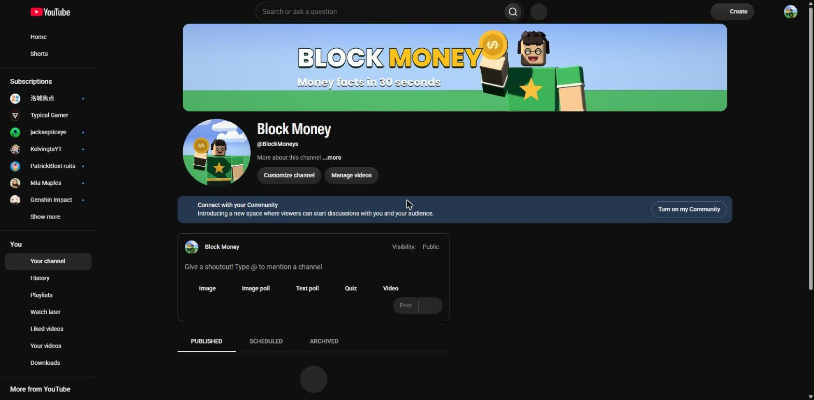

STATE: applied

# Block Money: profile picture and banner applied (Nov 17 2026)
- **Channel:** Block Money
- **Handle:** @BlockMoneys
- **Channel ID:** UC9vwlwhchNKGNuLyd5ReXRA
- **URL:** https://www.youtube.com/channel/UC9vwlwhchNKGNuLyd5ReXRA

**Owner approval:** the owner approved this directly in Creator's chat ("Yes, set both"). The owner also said Block Money is a channel they **created**, not the renamed "Dev Money Explained". Dev Money Explained still exists separately in the switcher.

**Studio history:** earlier today Studio showed this same channel ID as "What-If Sims" (@WhatIfSimsHQ-m1k). It now reads Block Money / @BlockMoneys.

## What was done
1. **Files checked:** fetched from claude/beautiful-hypatia-0w2o96 @ 2c506a9; both match `finance/brand/SHA256SUMS`.
   - `block_money_pfp_800.png`: 9ac1557f3702fafe…6d55
   - `block_money_banner_2560x1440.png`: 3fd401f978ef6838…2230
2. **Channel confirmed:** Studio's selected channel (`#entity-name`) read exactly "Block Money" on the Customization page before any upload.
3. **Picture:** Customization → Profile → Picture → Upload. Default crop kept (the whole image inside the circle) → Done.
4. **Banner:** Banner image → Upload. Default crop kept: the title, tagline and character's head are inside the "all devices" safe area; the body and coin stacks show only on TV/desktop → Done.
5. **Published.** No limit, approval or verification prompt appeared, and no password or 2FA was asked for.
6. **Nothing else touched:** the name stayed "Block Money", the handle "BlockMoneys", and the description, links and watermark are unchanged (checked before publishing).

## Result
The public channel page shows the new banner and picture (screenshot below). The Studio sidebar avatar can take a few minutes to update.

