# Recipe guide: a Block Money Short as a list of shots

A recipe is one JSON file, `finance/shorts/<slug>/recipe.json`. It lists the shots: where, which camera, who does what, which props move, which effects fire. Each shot starts on a **word of the voice-over**, so the timing follows the voice.

```
finance/shorts/<slug>/recipe.json + vo/timings.json
        │  node tools/recipe_build.mjs <slug>
        ▼
src/shorts/<slug_>.recipe.gen.ts → <Pascal>Recipe and <Pascal>RecipeSub in src/index.toolkit.ts
        + clip QA + the frame-0 gate → finance/shorts/<slug>/RECIPE_QA.md (exit 1 on a clip or a FAIL)
```

The reference port is `finance/shorts/minimum-payment-trap/recipe.json`. It has 22 shots in 46 lines. The hand-written version, `src/fin/v1/mintrap.tsx`, is 339 lines. `recipe_compare_a.jpg` and `recipe_compare_b.jpg` in that folder put them side by side: the hand-written stills on top, the recipe below.

## 1. Workflow

1. **Script and voice.** Write `script.txt` and record the voice as usual. Run Whisper to get `vo/timings.json`.
   - To draft before the voice exists, run `python tools/make_timings.py script.txt vo/timings.json`. It writes synthetic timings at 2.8 words/s.
   - Swap in the real timings later. Nothing else changes, because shots anchor to words.
2. **Write the recipe.** Copy the style example from section 5 that fits the Short.
3. **Check without writing anything.** Run `node tools/recipe_build.mjs <slug> --check`. Fix every `CLIP` and every `FAIL` it reports. The error messages name the bad word, anchor, target or preset, and list the valid ones.
4. **Build.** Run `node tools/recipe_build.mjs <slug>`. It writes the composition, `RECIPE_QA.md` and `out/tmp/<slug>.cues.json`.
5. **Stills.** For one still:
   ```
   npx remotion still src/index.toolkit.ts <Pascal>Recipe out.jpg --frame=N --scale=0.4
   ```
   - Add `--gl=swangle` on a machine without a GPU.
   - On the PC the GPU path is `--gl=angle`.
   - To compare against a hand-written Short, run `bash tools/recipe_compare.sh <Ref> <Recipe> out.jpg 0 40 90 ...`.
6. **Render.** Use the existing `render.sh` flow on `<Pascal>RecipeSub`, which has 4 sub-frames for motion blur, pointing it at `src/index.toolkit.ts`.
7. **Audio.** Mix the audio, then set loudness:
   ```
   STORY_CUES=out/tmp/<slug>.cues.json python tools/story_mix.py <Pascal>Recipe voice.wav <audio_dir> premix.wav
   bash tools/mux_voice.sh ...
   ```

`src/Root.tsx` and the hand-written Shorts are untouched. The recipe compositions live in `src/index.toolkit.ts`, so a builder's work-in-progress `.tsx` can never break a recipe render.

## 2. The schema (src/fin/recipe/types.ts)

```jsonc
{
  "slug": "minimum-payment-trap", "style": "S1",           // S1..S6 (finance/FORMAT_V1.md)
  "hook": { "text": "19 YEARS TO PAY OFF A TV", "until": "end:years", "again": "7:you#2" }, // <= 8 words, frame 0
  "duration": 23.3,                                        // s; default = the voice length
  "music": "upbeat", "cast": { "spender": "SPENDER", "saver": "SAVER" },  // looks: SPENDER SAVER SELLER DAD KID
  "tag": { "text": "EXAMPLE", "from": "five", "until": "done+1" },
  "props": [ { "id": "jar", "kit": "jar", "at": [-4, 0, -2.4], "from": "wrong", "until": "5:nineteen" } ], // multi-shot props
  "shots": [
    { "at": "nineteen", "set": "store", "mood": "whisper",
      "cam": { "preset": "slamZoom", "target": "spender.face", "hit": "nineteen", "dist": 1.5, "az": 0, "fov": 44 },
      "actors": [{ "id": "spender", "pose": "shock", "at": "mark", "from": "nineteen", "squash": ["nineteen"],
                   "then": [{ "at": "years", "pose": "despair" }] }],
      "props": [{ "id": "tv", "asset": "tv", "at": "counterTop", "motion": "dropSlam", "hit": "nineteen" }],
      "fx": ["shake", { "fx": "dust", "at": "nineteen+0.1", "p": "counterTop" }],
      "caption": "auto", "sfx": [{ "at": "years", "sfx": "gasp", "db": -6 }] }
  ]
}
```

**Times (`At`).** A time can be written in these forms:

| Form | Meaning |
|---|---|
| `2.4` | seconds |
| `"word"` | the first occurrence of the word. Case and punctuation are ignored. |
| `"word#2"` | the 2nd occurrence |
| `"3:word"` | the word in line 3 |
| `"end:word"` | the end of the word |
| `"line:3"` / `"lineEnd:3"` | the start / end of line 3 |
| `"word+0.12"` / `"word-0.1"` | an offset on any of the forms above |

- Poses start 2 frames before their word (LEAD), because reactions should lead the voice.

**Places.** A place can be written in these forms:

| Form | Meaning |
|---|---|
| `[x, z]` | a point on the floor |
| `[x, y, z]` | a point in space |
| `"anchor"` | a named anchor of the set (section 3.5) |
| `"anchor:dx,dy,dz"` | an anchor plus an offset |
| `"spender.handR"` / `"spender.handL"` | a prop carried in that hand. Held props are skipped by the clip QA. |
| `"spender.face"` / `"spender.head"` | dynamic places that follow the actor |

- The lens side is +z, and actors face the lens unless `face` says otherwise.
- `face` can be degrees, a target, or a prop id.

**Camera targets.** A target can be `"spender"` (the body), `"spender.face"`, `"spender.hands"`, `"spender.feet"`, a prop `id`, an anchor (with an optional offset), or `[x, y, z]`.
- `az` is the azimuth in degrees; 0 = straight from +z.
- `dist` and `h` override the preset's distance and height.
- `face` is where the target sits in the frame (0 = top).

**Props.** A prop is either a CC0 `asset` from the catalogue (section 3.6) or one of our `kit` pieces:

| Kit piece | Fields |
|---|---|
| `tv` | `text` = the screen |
| `card`, `reader`, `coin`, `bill` | (none) |
| `debtBlock`, `block` | `text`, `size`, `color` |
| `label` | `text`, `size`, `color` |
| `jar` | `fill` 0 to 1.2, `text`, `color` |
| `coinPile` | `size` = [r, h] |
| `calendar` | `text` = [title, value, sub] |
| `stamp` | `text`, `size` |
| `payBox` | `text` |
| `counter` | (none) |

## 3. Presets (every one goes through the clip QA)

The thumbnails come from the `PresetGallery` composition (`src/fin/recipe/gallery.ts`, rendered by `bash tools/preset_sheet.sh`). It has one 1-second shot per preset. `recipe_build`'s QA covers all of them: 0 clips.

### 3.1 Poses (src/fin/recipe/poses.ts)

| | pose | what it does |
|---|---|---|
| 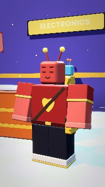 | `idle` | standing, arms relaxed (+ the idle layer: breathing, sway, blinks) |
| 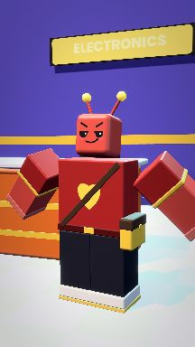 | `smug` | hands on hips, chin up (sly) |
| 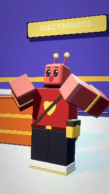 | `shock` | arms flung up, antennae straight, leaning back; pairs with `squash` |
| 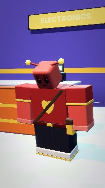 | `despair` | arms hanging, head down, antennae drooped (sad) |
| 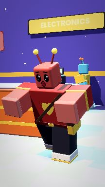 | `push` | arms forward, leaning in, feet apart: the hip height comes from the leg angles, so no sinking |
| 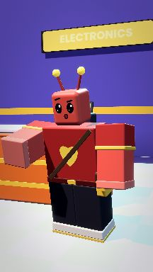 | `reach` | one arm reaching forward (curious) |
| 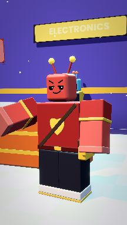 | `swipe-card` | right arm sweeps across at `from` (hold a card with `at: "spender.handR"`) |
| 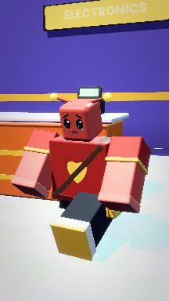 | `kneel` | down on one knee: rigid legs split front/back, hip lowered by legDrop so the soles stay on the floor |
| 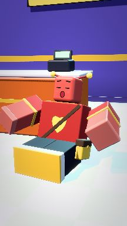 | `collapse` | shock, then sits down hard on the floor, leaning back |
| 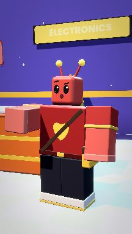 | `point` | right arm points at the lens |
| 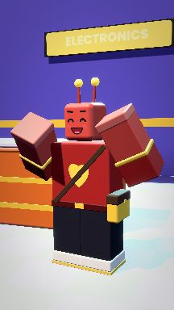 | `celebrate` | both arms pumping, small hop (joy) |
| 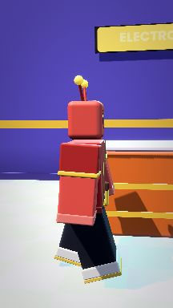 | `walk` | walk cycle from `at` to `to` at 1.3 m/s |
| 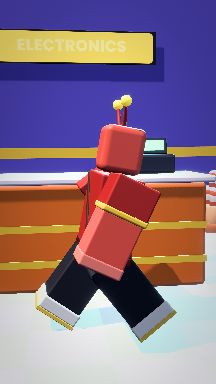 | `run` | run cycle from `at` to `to` at 3.2 m/s, leaning in |

Blocky limbs are rigid (no knees, no elbows). Every standing pose is **re-grounded**: the hip height comes from the actual leg angles minus the torso pitch, because the legs hang from the pitched root. The QA rejects soles more than 1.2 cm below the floor or 3 cm above it.

The QA found that the hand-written poses that lean the torso (shock, despair, reach) pushed the soles 1-2 cm into the floor. The recipe compiler fixes this for every pose.

### 3.2 Cameras (CAM_PRESETS in src/fin/recipe/compile.tsx)

| | camera | what it does |
|---|---|---|
| 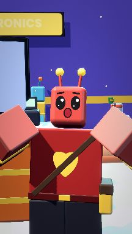 | `slamZoom` | fov slams 60 to the preset fov at `hit`, then creeps; impact kick; auto `impact` sfx |
| 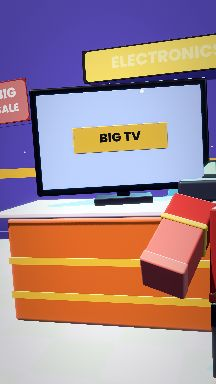 | `whip` | look swings 35° onto the target in 0.22 s (quintic glide), roll 4° to 0, motion blur shutter 0.2; auto `whoosh` |
| 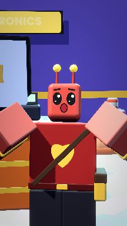 | `pushIn` | push-in 0.3 %/f with a 0.6 %/f punch for 35 f (mromidev pushK) |
| 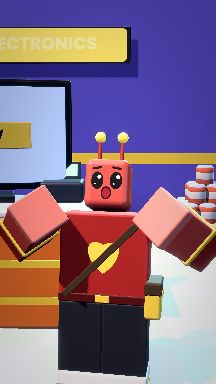 | `orbit` | lens orbits ±22° around the target over the shot |
| 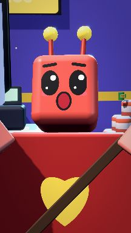 | `closeUp` | 1.3 m, fov 42, face high, slow push |
| 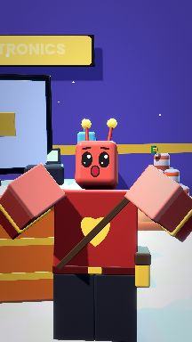 | `medium` | 2.6 m, fov 48, slow push |
| 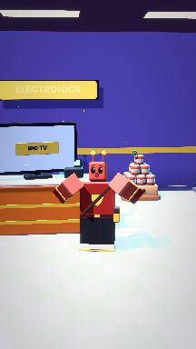 | `wide` | 5.4 m, fov 54 (not allowed in the first 1 s: the gate fails it) |
| 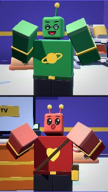 | `splitScreen` | S2: two lenses stacked (top = targets[0], bottom = targets[1]), 960 px each, one shared scene |
| 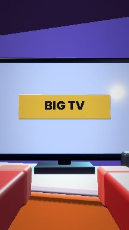 | `povFirstPerson` | S3: the lens sits in targets[0]'s head looking at targets[1]; that actor is hidden and two first-person forearms show low in frame |

Every preset keeps moving: a push, an orbit or a slam creep, with no static holds (FORMAT v1).

### 3.3 Prop motions

| | motion | what it does |
|---|---|---|
| 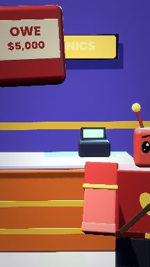 | `dropSlam` | falls `drop` m (default 2.4) and lands on `hit` with a squash, bounces; kick + `impact`/`thud`. `drop: 1.0` keeps it in frame at frame 0 (mid-fall) |
| 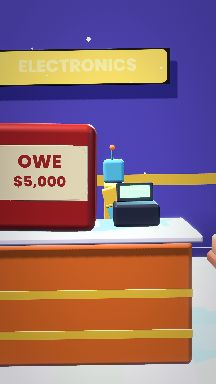 | `fly-in` | arcs in from `from` (default left-high-front), spinning, lands on `hit` with an overshoot (EASE_PLACE) |
| 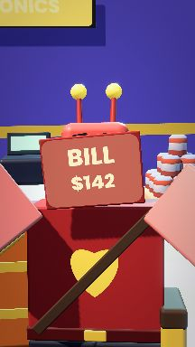 | `stick-to-face` | flies onto `on`'s face and sticks OUTSIDE the head box (head half-depth + its own half-depth + 3 cm), wobbles; `punch` sfx |
| 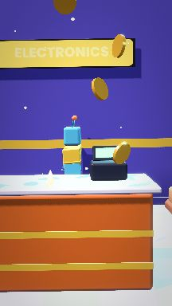 | `rain` | `n` copies falling in an `area` [w, d] around `at`, looping; each copy is QA-checked |
| 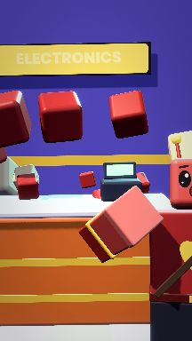 | `burst` | squashes for 0.25 s, then bursts into 20 cubes thrown away from the lens side; kick + `boom`/`crash` |
| 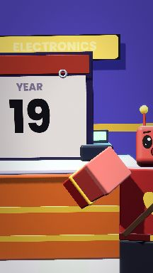 | `count-up` | the text counts `count.from` to `count.to` over `dur` from `hit` (prefix/suffix, thousands separators); `coins` + `ding` |

### 3.4 Effects

| | fx | what it does |
|---|---|---|
| 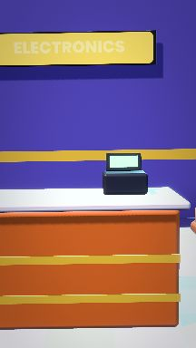 | `shake` | impact kick at `at`: 7 frames, sign flips each frame, decay (1-n/7)^1.5 (mromidev kickAt) |
| 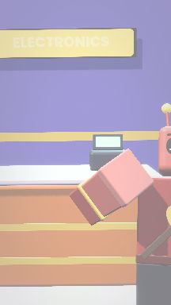 | `flash` | white flash, 0.65 to 0 over 0.12 s (use once, at the twist) |
| 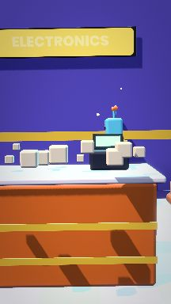 | `dust` | dust cubes puff out along the floor at `p` |
| 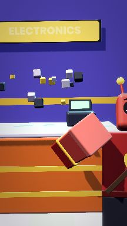 | `debris` | small blocks thrown out from `p`, bouncing twice on the floor; `crash` sfx |

### 3.5 Sets (src/fin/recipe/sets.tsx)

| | set | what it does |
|---|---|---|
| 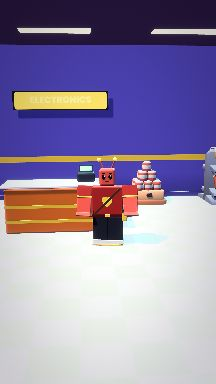 | `store` | the v1 ELECTRONICS store: counter (top 0.98 m), CC0 shelves, cans, vending. Anchors: counter, counterTop, mark, left, right, back, backLeft, backRight, wall, centre |
| 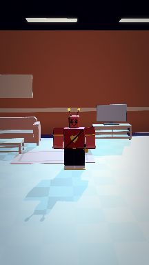 | `home` | living room: sofa, TV on a stand, rug, coffee table, lamp, fridge, bookcase. Anchors: sofa, tv, table, mark, left, right, back, wall, centre |
| 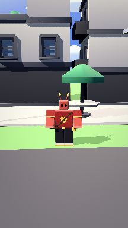 | `street` | outdoor: pavement, road, shop row, office towers, street lights, trees, sky. Anchors: kerb, mark, left, right, road, shop, centre |
| 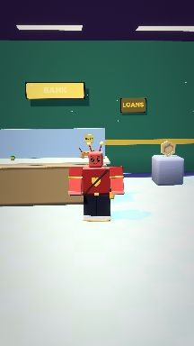 | `bank` | green hall, BANK sign, teller counter with glass, vault chest, coin on a plinth. Anchors: counter, counterTop, vault, mark, left, right, teller, back, wall, centre |
| 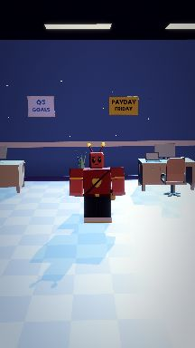 | `office` | blue office: two desks with monitors, chairs, bookcase, plant, coat rack. Anchors: deskL, deskR, mark, left, right, back, wall, centre |

The sets keep their dressing against the walls, so the floor from x -4.2 to 4.2 is free for a story's own props. Set pieces are static QA boxes: no actor may enter them.

### 3.6 CC0 props (src/fin/lib/assets.tsx)

`<Asset id="tv" p={[x, y, z]} yaw={rad} s={1} />` loads one prop. In a recipe, use `"asset": "tv"`.
- Every asset is normalised: real-world metres, the bottom centre on `p`, the front facing +z.
- `assetsTagged("money")` and `assetSize(id)` read the catalogue.
- `public/assets/cc0/catalog.json` lists all 155 assets, with tags and sizes.
- Contact sheets of every asset: `bash tools/asset_sheet.sh`, which writes `out/assets/sheet_*.jpg`.
- Licences: `public/assets/cc0/LICENSES.md`.

Useful ids by story:

| Story | Ids |
|---|---|
| Money | `coin-gold`, `coin-silver`, `coin-bronze`, `jewel`, `chest`, `slot-machine`, `prize-wheel`, `register`, `register-self` |
| Store | `shelf-boxes`, `shelf-bags`, `display-*`, `freezer`, `cart`, `basket`, `vending`, `gacha`, `clothing-rack` |
| Home | `tv`, `tv-vintage`, `sofa`, `bed`, `fridge`, `washer`, `laptop`, `monitor`, `desk`, `lamp-*`, `plant`, `cardboard-box` |
| Street | `car-*`, `q-*` cars, `house-*`, `shop-*`, `office-tower-*`, `streetlight`, `traffic-light`, `cone`, `dumpster`, `tree-*` |
| Food (small spends) | `coffee`, `frappe`, `burger`, `fries`, `pizza-box`, `soda-can`, `donut`, `avocado`, `cake` |

## 4. What the build checks (tools/recipe_build.mjs)

**Clip QA.** It checks every output frame plus 4 sub-frames:
- every prop and set box against every actor's head, torso, hands and forearms (oriented props allowed);
- props below the floor;
- feet sinking or floating;
- one actor's body inside another's.

It uses the same box maths as `tools/story_qa.mjs`, extended with feet, hands and set pieces.

**Frame-0 gate** (FORMAT_V1 "PRE-POST GATE", plus the "Day-1 data and fixes" of 2026-11-18):
- At frame 0, some subject covers at least 50 % of the frame height. This is a real projection through the frame-0 camera, clipped to the frame.
- The hook text is on screen at frame 0 and has **5 words or fewer** (day-1 fix 2).
- A `$` amount or a time is on screen by 0.5 s.
- The first word is spoken by **0.2 s**.
- A **sound punch at 0.00 s**: impact, drop, crash, rip and so on. The compiler adds `impact` at 0; `"sfx0"` picks another.
- **No character names in the first 2 s of speech** (day-1 fix 1). Line 1 is about "you" or a plain person.
- **No tag before 1.0 s.** Word captions also start at 1.0 s, so frame 0 has ONE text layer (day-1 fix 2).
- **2-3 cuts or big moves in the first 3 s**: shot changes, slams, drops, bursts or `shake` hits (day-1 fix 5).
- Music and an SFX play at frame 0.
- An emotion changes by 1.5 s.
- No wide or dark shot in the first 1 s.
- The length is 20-30 s. This one is a warning only.

The reference port `minimum-payment-trap` (live; 59.7 % stayed on day 1) passes the clip QA. It FAILS two day-1 checks: its hook has 7 words, and its line 1 opens with "Spender". These are exactly the shared problems the day-1 data points at. The recipe is kept as a faithful port of the published Short.

**Typical fixes:**
- `CLIP x spender.handR`: move the prop, or change the pose.
- `feet float`: a non-grounded pose was used for standing.
- Frame 0 under 50 %: lower `dist`, or use `closeUp` or `slamZoom`.
- Hook too long: cut it to 5 words. Fewer than 2 moves in the first 3 s: add a cut, a `dropSlam`, or `"fx": [{"fx": "shake", "at": "<word>"}]`.
- A name in the first 2 s: open on "you" or the money, and bring the name in later.
- No stake: put the `$` or the time in the hook text, or drop a label at frame 0.
- No emotion change: add `then: [{ at: <early word>, pose }]`.

## 5. One example per style (each passes the QA and the gate)

Each example lives in `docs/recipe_examples/<slug>/` with `script.txt`, synthetic `vo/timings.json` and `recipe.json`. They are registered as compositions (`S1SplitPaymentsRecipe` and so on), so you can render and look at them.

**These are demonstrations of the format, not finished Shorts.** The facts in the example scripts are illustrative and have not been checked against sources. A real Short still needs `sources.md` and the usual MAIN QA.

### S1 STORY: Spender's mini-drama, with slams

Script (`docs/recipe_examples/s1-split-payments/script.txt`):

> Four easy payments for new sneakers. Then Spender did it nine more times.
> Each one felt tiny. Forty dollars here, sixty there.
> But wait till you see the first of the month.
> Ten payments hit on the same day. Five hundred dollars, gone at once.
> Saver has one rule: if you can't pay it today, you can't afford it.
> So before you split it, add up every split you already have.

```json
{
  "slug": "s1-split-payments",
  "style": "S1",
  "hook": {"text": "$500 GONE IN ONE DAY", "again": "6:before"},
  "cast": {"spender": "SPENDER", "saver": "SAVER"},
  "tag": {"text": "EXAMPLE", "from": "forty", "until": "line:5"},
  "shots": [
    {"at": 0, "set": "store", "cam": {"preset": "slamZoom", "target": "spender", "hit": 0.3, "dist": 2.2, "az": -10}, "actors": [{"id": "spender", "pose": "smug", "at": "mark", "then": [{"at": "easy", "pose": "celebrate"}]}], "props": [{"id": "shoes", "asset": "cardboard-box", "at": "counterTop:0.4,0,0.1", "motion": "dropSlam", "hit": 0.3, "drop": 0.9}], "fx": [{"fx": "dust", "at": 0.3, "p": "counterTop:0.4,0.02,0.1"}]},
    {"at": "then", "cam": {"preset": "medium", "target": "spender", "dist": 3.0, "az": -25}, "actors": [{"id": "spender", "pose": "celebrate", "at": "mark"}], "props": [{"id": "boxes", "asset": "box", "s": 0.6, "at": "left", "motion": "rain", "n": 9, "area": [1.4, 0.8]}]},
    {"at": "tiny", "cam": {"preset": "closeUp", "target": "price", "dist": 1.4}, "actors": [{"id": "spender", "pose": "smug", "at": "mark"}], "props": [{"id": "price", "kit": "label", "text": "$40", "at": "counterTop:0.2,0.5,0.4", "motion": "fly-in", "hit": "forty"}, {"id": "price2", "kit": "label", "text": "$60", "at": "counterTop:-0.6,0.8,0.4", "motion": "fly-in", "hit": "sixty"}]},
    {"at": "wait", "set": "home", "cam": {"preset": "pushIn", "target": "cal", "dist": 2.2}, "props": [{"id": "cal", "kit": "calendar", "text": ["DAY", "1", "FIRST OF THE MONTH"], "at": "wall"}]},
    {"at": "4:ten", "cam": {"preset": "slamZoom", "target": "bills", "hit": "4:ten", "dist": 3.4}, "actors": [{"id": "spender", "pose": "shock", "at": "mark", "from": "4:ten", "squash": ["4:ten"]}], "props": [{"id": "bills", "kit": "debtBlock", "text": ["DUE", "$500"], "size": [1.2, 1.2, 0.7], "at": "left:0,0,-1.2", "motion": "dropSlam", "hit": "4:ten"}], "fx": [{"fx": "dust", "at": "4:ten", "p": "left:0,0.02,-1.2"}]},
    {"at": "gone", "mood": "whisper", "cam": {"preset": "closeUp", "target": "spender.face", "dist": 1.6}, "actors": [{"id": "spender", "pose": "collapse", "at": "mark", "from": "gone"}], "fx": ["shake"]},
    {"at": "saver", "mood": "ending", "cam": {"preset": "medium", "target": "saver", "dist": 2.8}, "actors": [{"id": "saver", "pose": "point", "at": "mark", "then": [{"at": "afford", "pose": "smug"}]}], "props": [{"id": "rule", "kit": "stamp", "text": "PAY IT TODAY?", "at": "mark:-0.9,1.4,0.4", "hit": "rule"}]},
    {"at": "6:before", "cam": {"preset": "slamZoom", "target": "spender.face", "hit": "6:before", "dist": 1.4}, "actors": [{"id": "spender", "pose": "point", "at": "mark", "from": "6:before"}]}
  ]
}
```

### S2 RICH-VS-POOR: split screen, the same situation side by side

Script (`docs/recipe_examples/s2-same-paycheck/script.txt`):

> Same paycheck. Two thousand dollars. Only one of them is broke by Friday.
> Saver moves two hundred to savings the day it lands.
> Spender spends first and saves whatever is left. Nothing is left.
> But the real gap shows up later.
> After one year, Saver has twenty four hundred dollars put away.
> Spender has a closet full of stuff and zero dollars. Which one are you?

```json
{
  "slug": "s2-same-paycheck",
  "style": "S2",
  "hook": {"text": "SAME $2,000. ONE IS BROKE.", "again": "which"},
  "cast": {"spender": "SPENDER", "saver": "SAVER"},
  "tag": {"text": "EXAMPLE", "from": "line:2", "until": "line:6"},
  "shots": [
    {"at": 0, "set": "office", "cam": {"preset": "splitScreen", "targets": ["saver", "spender"], "dist": 2.0}, "actors": [{"id": "saver", "pose": "smug", "at": "left"}, {"id": "spender", "pose": "celebrate", "at": "right", "then": [{"at": "thousand", "pose": "shock"}]}], "props": [{"id": "payS", "kit": "label", "text": "$2,000", "color": "#1f9e4f", "at": "left:0,1.75,0.35", "motion": "dropSlam", "hit": 0.25, "drop": 0.6}, {"id": "payP", "kit": "label", "text": "$2,000", "at": "right:0,1.75,0.35", "motion": "dropSlam", "hit": 0.25, "drop": 0.6}], "fx": [{"fx": "shake", "at": "only"}]},
    {"at": "saver", "cam": {"preset": "pushIn", "target": "jar", "dist": 2.4}, "actors": [{"id": "saver", "pose": "reach", "at": "left", "face": "jar"}], "props": [{"id": "jar", "kit": "jar", "text": ["SAVINGS"], "fill": 0.2, "color": "#1f9e4f", "at": "left:-1.1,0,-0.6"}, {"id": "in", "kit": "coin", "at": "left:-1.1,1.6,-0.6", "motion": "rain", "n": 6, "area": [0.3, 0.2]}]},
    {"at": "spender", "set": "store", "cam": {"preset": "whip", "target": "spender", "dist": 2.8}, "actors": [{"id": "spender", "pose": "swipe-card", "at": "mark", "from": "spends"}], "props": [{"id": "card", "kit": "card", "at": "spender.handR"}]},
    {"at": "nothing", "cam": {"preset": "slamZoom", "target": "spender.face", "hit": "nothing", "dist": 1.5}, "actors": [{"id": "spender", "pose": "despair", "at": "mark", "from": "nothing"}]},
    {"at": "line:4", "set": "office", "cam": {"preset": "wide", "target": "centre:0,1,0", "dist": 5.5}, "props": [{"id": "cover", "kit": "label", "text": ["1 YEAR", "LATER"], "size": [1.2, 0.6, 0.05], "at": "wall"}]},
    {"at": "after", "cam": {"preset": "splitScreen", "targets": ["sJar", "spender"], "dist": 2.2}, "actors": [{"id": "saver", "pose": "celebrate", "at": "left"}, {"id": "spender", "pose": "despair", "at": "right"}], "props": [{"id": "sJar", "kit": "label", "text": ["SAVED"], "color": "#1f9e4f", "at": "left:0,1.9,0.3", "motion": "count-up", "hit": "twenty", "count": {"from": 0, "to": 2400, "prefix": "$"}}, {"id": "pJar", "kit": "label", "text": ["SAVED", "$0"], "at": "right:0,1.9,0.3"}]},
    {"at": "which", "cam": {"preset": "slamZoom", "target": "spender.face", "hit": "which", "dist": 1.4}, "actors": [{"id": "spender", "pose": "point", "at": "mark", "from": "which"}]}
  ]
}
```

### S3 POV-YOU: a first-person camera, the viewer is the character

Script (`docs/recipe_examples/s3-pov-first-paycheck/script.txt`):

> POV: you just got your first paycheck. Eighteen hundred dollars.
> You open the app and the new phone is right there.
> Your friend says you deserve it. But hold on.
> Rent is due in nine days. Rent is twelve hundred dollars.
> You put three hundred aside first, then you look at the phone again.
> It still looks good. But now you can still pay rent.

```json
{
  "slug": "s3-pov-first-paycheck",
  "style": "S3",
  "hook": {"text": "POV: $1,800 PAYCHECK", "again": "line:6"},
  "cast": {"you": "SPENDER", "friend": "SAVER"},
  "tag": {"text": "EXAMPLE", "from": "rent", "until": "line:6"},
  "shots": [
    {"at": 0, "set": "home", "cam": {"preset": "povFirstPerson", "targets": ["you", "pay"]}, "actors": [{"id": "you", "pose": "reach", "at": [0.2, 1.0], "face": [0, 0, -1], "then": [{"at": "first", "pose": "celebrate"}]}], "props": [{"id": "pay", "kit": "label", "text": ["PAYCHECK", "$1,800"], "color": "#1f9e4f", "size": [1.0, 0.62, 0.05], "at": [0.2, 1.5, 0.35], "motion": "fly-in", "hit": 0.08}], "fx": [{"fx": "shake", "at": "first"}, {"fx": "shake", "at": "eighteen"}]},
    {"at": "open", "cam": {"preset": "povFirstPerson", "targets": ["you", "phone"]}, "actors": [{"id": "you", "pose": "reach", "at": [0.2, 1.0], "face": [0, 0, -1]}], "props": [{"id": "phone", "asset": "laptop", "at": [0.2, 0.9, 0.1], "glow": 0.3}, {"id": "plinth", "asset": "plinth", "s": 1.1, "at": [0.2, 0, 0.1]}]},
    {"at": "friend", "cam": {"preset": "closeUp", "target": "friend.face", "dist": 1.5}, "actors": [{"id": "friend", "pose": "point", "at": "mark", "emotion": "sly"}]},
    {"at": "hold", "cam": {"preset": "slamZoom", "target": "friend.face", "hit": "hold", "dist": 1.4}, "actors": [{"id": "friend", "pose": "shock", "at": "mark", "from": "hold"}]},
    {"at": "line:4", "cam": {"preset": "povFirstPerson", "targets": ["you", "cal"]}, "actors": [{"id": "you", "pose": "idle", "at": [0.0, 0.0], "face": [0, 0, -3]}], "props": [{"id": "cal", "kit": "calendar", "text": ["RENT DUE IN", "9", "$1,200"], "color": "#c01818", "at": "wall", "motion": "count-up", "hit": "nine", "count": {"from": 30, "to": 9, "dur": 0.5}}]},
    {"at": "aside", "cam": {"preset": "povFirstPerson", "targets": ["you", "jar"]}, "actors": [{"id": "you", "pose": "reach", "at": [0.0, 0.6], "face": [-1.6, 0, -1.4]}], "props": [{"id": "jar", "kit": "jar", "text": ["RENT"], "fill": 0.6, "color": "#1f9e4f", "at": "table:0,0,0"}]},
    {"at": "line:6", "cam": {"preset": "orbit", "target": "you", "dist": 2.6}, "actors": [{"id": "you", "pose": "celebrate", "at": "mark"}]}
  ]
}
```

### S4 WOULD-YOU-RATHER: a choice at frame 0, a pause to guess, then the reveal

Script (`docs/recipe_examples/s4-penny-or-million/script.txt`):

> A million dollars right now, or one penny doubled every day for thirty days?
> Think fast.
> Day ten, the penny is only five dollars. The million looks smart.
> Day twenty, about five thousand. Still losing.
> But doubling gets wild at the end.
> Day thirty, the penny is over five million dollars. Did you pick the penny?

```json
{
  "slug": "s4-penny-or-million",
  "style": "S4",
  "hook": {"text": "$1M OR A PENNY?", "until": "end:fast", "again": "end:penny#4"},
  "duration": 21.0,
  "cast": {"spender": "SPENDER", "saver": "SAVER"},
  "tag": {"text": "MATH CHECK", "from": "ten", "until": "end:penny#4"},
  "shots": [
    {"at": 0, "set": "bank", "cam": {"preset": "splitScreen", "targets": ["million", "penny"], "dist": 1.9}, "actors": [{"id": "spender", "pose": "point", "at": "left", "face": "million", "then": [{"at": "right", "pose": "shock"}]}, {"id": "saver", "pose": "smug", "at": "right"}], "props": [{"id": "million", "kit": "block", "text": ["$1,000,000"], "color": "#1f9e4f", "size": [1.0, 0.8, 0.6], "at": "left:-0.9,0,-0.6", "motion": "dropSlam", "hit": 0.25, "drop": 0.8}, {"id": "penny", "asset": "coin-bronze", "s": 1.4, "at": "right:-1.2,1.0,-0.5", "motion": "fly-in", "hit": 0.3}], "fx": [{"fx": "shake", "at": "now"}]},
    {"at": "think", "caption": "COMMENT YOUR PICK", "cam": {"preset": "orbit", "target": "centre:0,1.2,-0.3", "dist": 4.6}, "actors": [{"id": "spender", "pose": "smug", "at": "left"}, {"id": "saver", "pose": "smug", "at": "right"}], "props": [{"id": "q", "kit": "label", "text": ["?"], "size": [0.6, 0.6, 0.05], "at": "wall"}]},
    {"at": "ten", "cam": {"preset": "medium", "target": "day", "dist": 2.6}, "actors": [{"id": "spender", "pose": "celebrate", "at": "left"}], "props": [{"id": "day", "kit": "label", "text": ["DAY 10"], "size": [1.0, 0.5, 0.05], "at": "counterTop:0,0.5,0.2", "motion": "count-up", "hit": "ten", "count": {"from": 0.01, "to": 5, "prefix": "$", "dur": 0.6}}]},
    {"at": "twenty", "cam": {"preset": "pushIn", "target": "day", "dist": 2.4}, "props": [{"id": "day", "kit": "label", "text": ["DAY 20"], "size": [1.0, 0.5, 0.05], "at": "counterTop:0,0.5,0.2", "motion": "count-up", "hit": "twenty", "count": {"from": 5, "to": 5243, "prefix": "$", "dur": 0.8}}]},
    {"at": "but", "mood": "whisper", "cam": {"preset": "closeUp", "target": "saver.face", "dist": 1.4}, "actors": [{"id": "saver", "pose": "smug", "at": "right"}]},
    {"at": "thirty#2", "mood": "ending", "cam": {"preset": "slamZoom", "target": "pile", "hit": "thirty#2+0.2", "dist": 3.4}, "actors": [{"id": "spender", "pose": "collapse", "at": "left", "from": "five#3"}, {"id": "saver", "pose": "celebrate", "at": "right"}], "props": [{"id": "pile", "kit": "coinPile", "size": [1.2, 0.9, 1.2], "at": "back:0,0,0.4", "motion": "dropSlam", "hit": "thirty#2+0.2"}, {"id": "total", "kit": "label", "text": ["DAY 30"], "color": "#1f9e4f", "size": [1.4, 0.5, 0.05], "at": "back:0,1.6,0.9", "motion": "count-up", "hit": "five#3", "count": {"from": 10737, "to": 5368709, "prefix": "$", "dur": 0.9}}], "fx": [{"fx": "flash", "at": "five#3"}, "shake"]}
  ]
}
```

### S5 CHARACTER-TALKS: Spender speaks the lines (the voice is the character's)

Script (`docs/recipe_examples/s5-spender-talks/script.txt`):

> I pay twelve dollars a month for an app I forgot about. I'm Spender.
> And fifteen for a show I watched once. And nine for cloud storage.
> That's nothing, right? Just a few dollars.
> Then Saver made me add them up for a year.
> Four hundred thirty two dollars. For stuff I don't even use.
> So check your subscriptions today. I'm cancelling three right now.

```json
{
  "slug": "s5-spender-talks",
  "style": "S5",
  "hook": {"text": "$432 ON FORGOTTEN APPS", "again": "line:6"},
  "cast": {"spender": "SPENDER", "saver": "SAVER"},
  "tag": {"text": "EXAMPLE", "from": "line:4", "until": "line:6"},
  "shots": [
    {"at": 0, "set": "home", "cam": {"preset": "closeUp", "target": "spender.face", "dist": 1.6}, "actors": [{"id": "spender", "pose": "smug", "at": "mark", "then": [{"at": "pay", "pose": "shock"}]}], "props": [{"id": "sub1", "kit": "label", "text": "$12/MO", "at": "mark:-0.7,1.7,0.3", "motion": "fly-in", "hit": "twelve"}], "fx": [{"fx": "shake", "at": "twelve"}, {"fx": "shake", "at": "month"}]},
    {"at": "fifteen", "cam": {"preset": "medium", "target": "spender", "dist": 2.8, "az": 15}, "actors": [{"id": "spender", "pose": "point", "at": "mark", "face": "tv"}], "props": [{"id": "sub2", "kit": "label", "text": "$15/MO", "at": "mark:-0.9,1.9,0.2", "motion": "dropSlam", "hit": "fifteen", "drop": 0.8}, {"id": "sub3", "kit": "label", "text": "$9/MO", "at": "mark:0.9,1.9,0.2", "motion": "dropSlam", "hit": "nine", "drop": 0.8}]},
    {"at": "nothing", "cam": {"preset": "pushIn", "target": "spender.face", "dist": 1.8}, "actors": [{"id": "spender", "pose": "smug", "at": "mark"}]},
    {"at": "then", "cam": {"preset": "medium", "target": "saver", "dist": 2.8}, "actors": [{"id": "saver", "pose": "point", "at": "right", "face": "spender"}, {"id": "spender", "pose": "idle", "at": "left", "emotion": "curious"}], "props": [{"id": "receipt", "kit": "label", "text": ["1 YEAR OF", "SUBSCRIPTIONS"], "size": [0.9, 0.4, 0.05], "at": "right:-0.9,1.5,0.3", "motion": "fly-in", "hit": "add"}]},
    {"at": "line:5", "cam": {"preset": "slamZoom", "target": "spender.face", "hit": "line:5", "dist": 1.4}, "actors": [{"id": "spender", "pose": "shock", "at": "left", "from": "line:5", "squash": ["line:5"]}], "props": [{"id": "bills", "kit": "bill", "at": "left:0,0,0.8", "motion": "rain", "n": 12, "area": [1.4, 0.3]}], "fx": ["flash"]},
    {"at": "line:6", "mood": "ending", "cam": {"preset": "orbit", "target": "spender", "dist": 2.6}, "actors": [{"id": "spender", "pose": "celebrate", "at": "mark", "from": "cancelling"}], "props": [{"id": "cancel", "kit": "stamp", "text": "CANCELLED x3", "color": "#1f9e4f", "at": "mark:-0.9,1.3,0.4", "hit": "cancelling"}]}
  ]
}
```

### S6 COUNTDOWN: 3 traps, ranked, #1 is withheld

Script (`docs/recipe_examples/s6-three-traps/script.txt`):

> Three money traps you fall for every month. Number one is the worst.
> Number three: the free trial that turns into a bill.
> Number two: the store card with a ten percent discount and thirty percent interest.
> And number one? It looks like help.
> The minimum payment. Pay only that, and a small bill can follow you for years.
> Pay more than the minimum, and you skip all three traps.

```json
{
  "slug": "s6-three-traps",
  "style": "S6",
  "hook": {"text": "3 TRAPS. #1 IS WORST.", "again": "line:6"},
  "cast": {"spender": "SPENDER", "saver": "SAVER"},
  "tag": {"text": "EXAMPLE", "from": "line:2", "until": "line:6"},
  "shots": [
    {"at": 0, "set": "street", "cam": {"preset": "slamZoom", "target": "spender", "hit": 0.25, "dist": 2.4}, "actors": [{"id": "spender", "pose": "shock", "at": "mark", "from": 0.2}], "props": [{"id": "three", "kit": "block", "text": ["3"], "color": "#d62a2a", "size": [0.7, 0.7, 0.5], "at": "left", "motion": "dropSlam", "hit": 0.25, "drop": 1.0}, {"id": "every", "kit": "label", "text": ["$$ EVERY", "30 DAYS"], "size": [0.9, 0.4, 0.05], "at": "left:0,1.5,0.2", "motion": "dropSlam", "hit": 0.2, "drop": 0.6}], "fx": [{"fx": "dust", "at": 0.25, "p": "left"}]},
    {"at": "line:2", "set": "home", "cam": {"preset": "whip", "target": "trial", "dist": 2.4}, "actors": [{"id": "spender", "pose": "smug", "at": "mark"}], "props": [{"id": "trial", "kit": "label", "text": ["#3", "FREE TRIAL"], "size": [1.0, 0.5, 0.05], "at": "wall", "motion": "fly-in", "hit": "free"}, {"id": "bill", "kit": "label", "text": ["BILL", "$14.99"], "at": "spender.face", "motion": "stick-to-face", "on": "spender", "hit": "bill", "size": [0.36, 0.26, 0.04]}]},
    {"at": "line:3", "set": "store", "cam": {"preset": "medium", "target": "card", "dist": 2.6}, "actors": [{"id": "spender", "pose": "swipe-card", "at": "mark", "from": "store"}], "props": [{"id": "card", "kit": "label", "text": ["#2 STORE CARD", "-10% / +30%"], "size": [1.2, 0.5, 0.05], "at": "counterTop:0,0.6,0", "motion": "dropSlam", "hit": "store", "drop": 0.8}]},
    {"at": "line:4", "mood": "whisper", "cam": {"preset": "pushIn", "target": "cover", "dist": 2.4}, "props": [{"id": "cover", "kit": "block", "text": ["#1", "?"], "color": "#3a3f58", "size": [1.0, 1.0, 0.6], "at": "counterTop:0,0,0"}]},
    {"at": "line:5", "cam": {"preset": "slamZoom", "target": "spender.face", "hit": "line:5", "dist": 1.5}, "actors": [{"id": "spender", "pose": "despair", "at": "mark", "from": "years"}], "props": [{"id": "one", "kit": "debtBlock", "text": ["#1", "MINIMUM"], "size": [1.1, 1.1, 0.7], "at": "counterTop:-0.3,0,0", "motion": "burst", "hit": "years"}], "fx": ["shake"]},
    {"at": "line:6", "mood": "ending", "cam": {"preset": "medium", "target": "saver", "dist": 2.8}, "actors": [{"id": "saver", "pose": "celebrate", "at": "right"}, {"id": "spender", "pose": "idle", "at": "left", "emotion": "curious"}], "props": [{"id": "skip", "kit": "stamp", "text": "PAY MORE THAN THE MINIMUM", "color": "#1f9e4f", "size": [0.9, 0.2, 0.03], "at": "right:0,1.95,0.3", "hit": "skip"}]}
  ]
}
```

## 6. Borrowed code

Three helpers were rewritten from two MIT repositories: the camera kick, push-in and zoom (`src/fin/lib/camera.ts`); the motion easings and reaction lead (`src/fin/lib/motion.ts`); and the word-caption chunking (`src/fin/lib/captions.tsx`). The sources are mromidev/claude-animated-shorts and hassancs91/claude-faceless-shorts-creator. Their notices are in `THIRD_PARTY_NOTICES.md`. No AGPL code is used.
