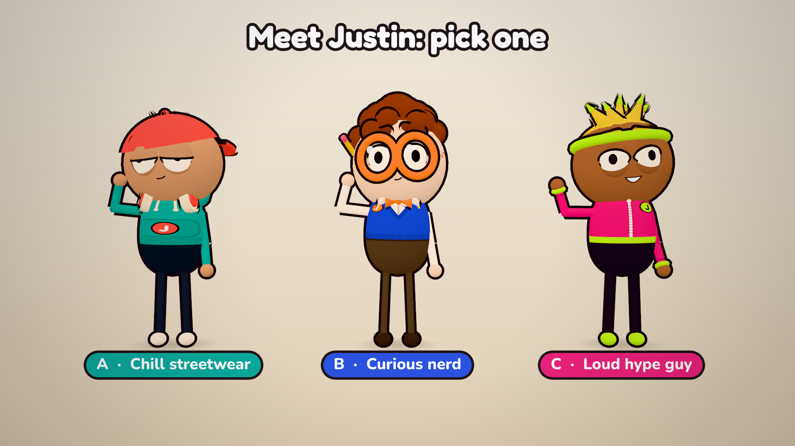

# Justin: host character, 3 versions to pick from

Justin is the original on-screen host for the Justin clips Shorts. He's built in the Toon 3D kit (`whatif/aitrends-2d-studio/kits/toon3d/`, branch `iawaken/toon3d-fx`) with the same bean body, toon shading and outline as the extras in the current Shorts (for example the exploding-whale Short on `justinclips/funny2`).



## Why he reads as the host, not an extra
These apply to all three versions:
- **Bigger head** (head scale about 1.1-1.16x) and a slightly taller body (1.06x).
- **Heavier outline:** 6 px, where extras use 3.2 px.
- **One loud signature colour.** The extras in our Shorts wear muted work clothes and tees (orange, olive, brown, blue).
- **A "J" badge on his chest.**
- **A signature headpiece or accessory** that changes his silhouette.
- **A friendly, slightly sarcastic face as his default** (`j.home`).

All three designs are original. Nothing is based on a real person, YouTuber, mascot, cartoon or brand.

## The versions
| | A: Chill streetwear | B: Curious nerd | C: Loud hype guy |
|---|---|---|---|
| Signature colours | teal `#13a89e` + coral `#ff5a4e` | cobalt `#2f54d6` + tangerine `#ff8a1f` | hot magenta `#e5267a` + lime `#b8f03a` |
| Outfit | oversized teal hoodie (hood down), kangaroo pocket with a coral J patch, dark joggers, white sneakers | white shirt + cobalt sweater vest, tangerine bow tie, pen in pocket, brown chinos | magenta track jacket with white zip + shoulder stripes, lime hem, dark track pants, lime sneakers |
| Hair / accessory | coral snapback worn backwards (brim sticks out), cream headphones round the neck, messy dark hair | GIANT round tangerine glasses, tall auburn curly hair, pencil behind the ear | bleached spiky hair with lime tips, lime sweatband + wristbands |
| Default face | lazy half-lid smirk with one brow up ("yeah, that really happened") | wide eyes, one brow way up, little smirk ("wait... actually") | big grin, brows up ("YO. You will NOT believe this") |
| Intro says | "hey." | "Hi!" | "HIII!" |
| Vibe | laid-back, dry | nerdy, curious, a bit of a know-it-all | loud, high energy, a hype man |

Files in each version's folder (`A/`, `B/`, `C/`):
- `still.png`: 1080x1920 front view, waving, plain gradient, labelled "Justin A/B/C".
- `poses.png`: 1920x1080 pose sheet: shocked, pointing at you, shrug/deadpan.
- `intro.mp4`: 3.5 s loop, 1080x1920, 24 fps, no audio. He pops in, says hi in a speech bubble, waves, blinks and pops out, so it loops cleanly.

`compare.png` (1920x1080) shows all three side by side, labelled A, B and C.

## Reusing Justin in a Short
The rig is `whatif/aitrends-2d-studio/kits/toon3d/justin.js`. It's a new file in the kit, and it only needs `rig.js` and `toon.js` from `iawaken/toon3d-fx`. Once the owner picks a version, use that letter everywhere.

```js
import { justin, JPOSE, JEXPR, justinIntro, INTRO_DUR } from '/kits/toon3d/justin.js';

registerShot('s01', { kind: '3d',
  init(T) { const st = toonStage(T, { light: 'sunny' }); const j = justin('A'); j.position.set(0, 0, 1); st.add(j); return { stage: st, j }; },
  draw(s, t) {
    s.j.pose(JPOSE.wave(t));          s.j.face(s.j.home, t);        // wave with his signature face (pass t for blinks/talk)
    // s.j.pose(JPOSE.shocked(t));    s.j.face(JEXPR.shocked, t);
    // s.j.rotation.y = 0.5; s.j.pointing(true); s.j.pose(JPOSE.pointCam(t, 0.5)); s.j.face(s.j.exprs.point, t);
    // s.j.pose(JPOSE.shrug(t));      s.j.face(JEXPR.deadpan, t);
    // s.j.face({ ...s.j.home, talk: 1 }, t);                         // talking
  },
});
```
- `justin(id, overrides)`: `id` is `'A'`, `'B'` or `'C'`. It returns a normal `bean()` group (`.pose`, `.face`, `.hand`, `.hold`, `.parts`), so everything in `rig.js` works on it, including `walk`, `run`, `nod`, `mixPose`, `mixExpr` and the reaction FX in `react.js`. Overrides take any `bean()` option plus `palette` and `outlinePx`.
- Extras on the returned group:
  - `.home`: his signature face.
  - `.exprs`: shared faces plus his own `point` face.
  - `.palette`: his colours.
  - `.pointing(on)`: shows the index finger and enlarges the hand.
  - `.jid` and `.isHost`.
- `JUSTIN`: the three presets (bean options, palette and a label).
- `JPOSE`:
  - `wave(t, k, base)`
  - `shocked(t)`
  - `pointCam(t, turn)`: set `rotation.y = turn` on the character as well.
  - `shrug(t)`
- `JEXPR`: `shocked`, `deadpan`, `smirk`.
- `justinIntro(j, t)`: drives the 3.5 s (`INTRO_DUR`) pop-in intro. It returns `{ scale, bubble, sparkle, squash }` for your overlay. `tall/scenes/avatar.js` shows how to draw the sparkle and the speech bubble.

## Re-rendering
The projects are in `justinclips/avatar/project/`: `tall/` is 9:16 (stills and intros) and `wide/` is 16:9 (pose sheets and comparison). Run these from `whatif/aitrends-2d-studio` on `iawaken/toon3d-fx`, after `npm install` and with `justin.js` copied into `kits/toon3d/`:
```
export CHROMIUM_PATH=/opt/pw-browsers/chromium
node render.mjs --project <repo>/justinclips/avatar/project/tall --stills 0.5,1.5,2.5          # still A, B, C
node render.mjs --project <repo>/justinclips/avatar/project/tall --from 3 --to 6.5 --out A.mp4 # intro A (B: 6.5-10, C: 10-13.5)
node render.mjs --project <repo>/justinclips/avatar/project/wide --stills 0.5,1.5,2.5,3.5      # poses A, B, C + compare
```
Then re-encode each intro with `ffmpeg -i X.mp4 -c:v libx264 -crf 18 -pix_fmt yuv420p -an -movflags +faststart intro.mp4`. Each intro takes about 45 s to render on 4 CPUs.

Nothing here has been posted or uploaded anywhere.
