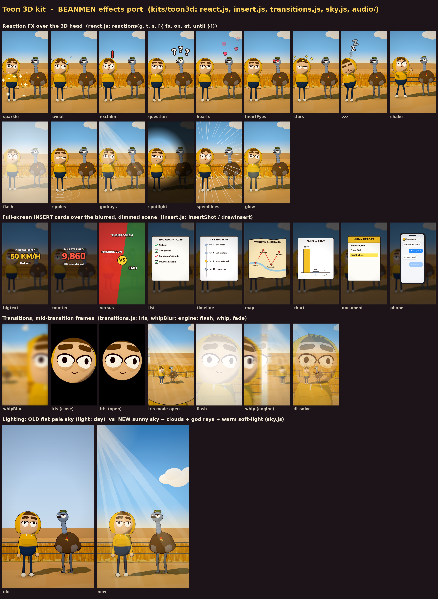

# toon3d: the "Toon 3D" style kit (I.Awaken)

Stylised 3D "bean" people in small furnished 3D rooms: big round head on a pill body, thin stick limbs, ball hands and
feet, soft matte toon shading, dark outline, faces that act with heavy lids and thick brows. Warm soft light with real
shadows. 1-3 word white captions with a dark outline in the lower middle.


Matches the reference *look* only (IAWAKEN_PLAYBOOK.md, "NEW ANIMATION STYLE"). All characters, names and sets here are original.

Runs inside the aiTrends 2D Studio engine as `kind: '3d'` shots (Three.js 0.169, shadows). Proof of use:
`projects/rome-sacked-short/` (9:16 Short, 15 shots).

## Files
| File | What |
|---|---|
| `toon.js` | `toonStage`, `toon()` material, `outline()` (inverted hull, constant on-screen width), primitives (`rbox`, `cyl`, `ball`, `lathe`, `floor`, `blob`), `LIGHT` presets, `camMove`, `drift` |
| `rig.js` | `bean(opts)` character factory, `POSE`, `EXPR`, `walk`, `run`, `point`, `shrug`, `idle`, `nod`, `shake`, `tremble`, `mixPose`, `addPose`, `mixExpr`, `CAST` presets |
| `cast.js` | the I.Awaken main cast as beans: `castMember(id, opts)`, `CAST3D`, `cat()` (BISCUIT), `phone()`, `stopwatch()` |
| `animals.js` | toon animals in the bean style: `emu({ general })` with `.update(t, { run, peck, lid, lidAngle, look, headTurn })` (used by the emu-war Short) |
| `props.js` | furniture + Roman props (`column`, `templeFront`, `facade`, `gate`, `tower`, `table`, `couch`, `throne`, `shelf`, `amphora`, `sack`, `shield`, `spear`, `torch`, `banner`, `stall`, `cart`, `chicken`, ...), textures `TEX.*` |
| `sets.js` | `SETS.romanStreet`, `SETS.romanHouse` (with `palace: true` for a throne room), `SETS.cityGate`, `applyLight` |
| `fx.js` | toon `fire`, puffy `smoke`, `embers`, additive `glow`, `skyGlow` (no gore: danger reads as fire, smoke, silhouettes) |
| `captions.js` | `useToonCaptions(opts)`, `drawToonCaption`, `chunkWords` (1-3 word chunks timed from `timeline/words.json`) |
| `react.js` | reaction FX pinned over a character's head: `reactions`, `shakeCam`, `anchor`, `drawFx`, `godRays` (BEANMEN port) |
| `insert.js` | full-screen INSERT cards (`bigtext counter versus list timeline map chart document phone`): `insertShot`, `drawInsert`, `dimScene` |
| `transitions.js` | `useToonTransitions()` adds `iris` and `whipBlur` shot transitions |
| `sky.js` | the sunny look: `sunnySky` (sky dome + sun glow + soft clouds), `sunnyLook` (god rays + soft-light tint), `applySunny`; `LIGHT.sunny` in toon.js |
| `audio/sfx/` (54) + `audio/music/` (6) | the owner's BEANMEN sound library (procedurally generated, royalty-free; generator: `audio/gen_audio_assets.py`), used as `toon3d:<name>` |
| `demo/` + `tools/make_fx_sheet.py` | `fx_sheet.png` (every FX/insert/transition + old vs new light), `fx_demo.mp4` (16.6 s proof clip), their projects |
| `sheet/` + `tools/make_sheet.py` | the style-sheet project and the script that composes `style_sheet.png` and `avatar_hero_800.png` |

Engine hooks this kit relies on (added with the kit, backward compatible): `engine/player.js` uses `E.captionFn` when a kit
sets it; `engine/styles.js` has a `toon` style (no grain, light vignette); `render.mjs` honours `CHROMIUM_PATH`.

## Quick start (one shot)
```js
// projects/<slug>/scenes/shots/03_guard.js
import { registerShot, ease, prog } from '/engine/core.js';
import { toonStage, camMove } from '/kits/toon3d/toon.js';
import { bean, CAST, POSE, EXPR, addPose, idle, mixExpr } from '/kits/toon3d/rig.js';
import { SETS } from '/kits/toon3d/sets.js';

registerShot('s03', { kind: '3d',
  init(T) {                                    // T = engine three-kit (renderer); build once per shot
    const st = toonStage(T, { light: 'night', fov: 40, target: [0, 0, 1] });
    const set = SETS.cityGate(st, { night: true, fireBeyond: true });
    const guard = bean(CAST.guard); guard.position.set(-2.4, 0, 1.6); st.add(guard);
    return { stage: st, set, guard };           // the player calls (st.stage || st).render()
  },
  draw(s, t, info) {                            // t = seconds into the shot
    s.set.update(t);                            // animates fire/smoke
    s.guard.pose(addPose(POSE.lean, idle(t)));
    s.guard.face(mixExpr(EXPR.bored, EXPR.asleep, ease.inOut(prog(t, 0.5, 1.5))), t);   // pass t for blinks
    camMove(s.stage, t, [[0, { pos: [-1.5, 2.4, 6.5], look: [-2.3, 2.0, 1.6], fov: 28 }], [info.dur, { pos: [-1.6, 2.35, 5.8], look: [-2.3, 2.0, 1.6], fov: 27 }]]);
  },
  overlay(g, t, info, s) { /* optional 2D drawing on top, logical units */ },
});
```
Captions: `scenes/kit.js` = `import { useToonCaptions } from '/kits/toon3d/captions.js'; useToonCaptions();` plus
`"captions": true, "style": "toon"` in config.json. Optional `"captionStyle": { "y": 0.70, "gold": ["410", "pepper"] }`.

## Units and axes
1 unit ~ 0.75 m. A bean stands ~2.55 units tall (head top), head centre ~2.1, eyes ~2.15, hands ~1.2. Doors ~2.3-4.6,
columns ~5-6. Characters face **+Z**; their LEFT is **+X**. Sets are built so the default camera sits at +Z looking toward -Z.
`rotation.y = Math.PI` turns a character away from camera; `Math.PI / 2` faces +X (screen right).

## `toonStage(T, opts)`
`{ light: 'warm'|'day'|'dusk'|'night'|'fire', fov: 30, bg: colour | [top, ..., bottom], fog: [near, far, colour], target: [x,y,z], shadowSize: 9, shadowMap: 2048, samples: 4, shadow: true, key: [colour, intensity, [dx,dy,dz]], fill: [...], ambient, exposure }`
Returns `{ scene, camera, key, fill, hemi, add(...objs), cam(pos, look, fov), render(), exposure }`. `target` centres the
shadow camera (keep it near the action; `shadowSize` is the half-width of the shadowed area). `applyLight(st, 'fire')`
swaps the mood in place. Neutral tone mapping, MSAA x4, PCF soft shadows. `camMove(st, t, keys, ease)` keyframes
`{pos, look, fov}`; `drift(t, amp, seed)` adds a hand-held wobble.

## Materials and outline
- `toon(colour, { map, emissive, ... })`: shared `MeshToonMaterial` with a soft 6-step ramp (lifted shadows, never black).
- `outline(object, { px: 3, color: INK })`: adds a back-face hull to every mesh under `object`. Width is constant on screen
  (px of the 1080-wide frame), capped at 0.035 units. Skip a mesh with `mesh.userData.noOutline = true`; per-mesh width
  with `mesh.userData.outlinePx`. Call it **after** the object is built. Characters use 3.2 px, props 2.6, big architecture 2.2.
- Hard-edged boxes split their hull at the corners: use `rbox()` (rounded) for props that should be outlined; flat walls and
  floors use `plane`/`floor`/`box` without outline, like the reference.
- `blob(r, opacity)`: soft contact shadow under feet and furniture (fake AO).

## Characters: `bean(opts)`
```
bean({ name, outfit: 'tunic'|'toga'|'armour'|'uniform'|'striped'|'rags'|'robe',
       colors: { main, trim, stripe, belt, metal, sash, legsTop, sleeveColor, gloves },
       skin: 'light'|'fair'|'olive'|'tan'|'brown'|'dark'|'#hex',
       hair: 'bald'|'bowl'|'curly'|'swoop'|'spiky'|'bun'|'horseshoe'|'long', hairColor, browColor, beard: bool, beardColor,
       head: 'none'|'helmet'|'laurel'|'cap'|'cone'|'hood', headColor, crestColor, helmetTrim,
       scale: 1, seed (blink timing + hair variation), silhouette: bool, silhouetteColor, outlinePx, shadowBlob: true,
       noPads, noDrape })
```
Outfits: `tunic` (belt, V neck, optional `stripe` = clavi), `toga` (sash with coloured trim + shoulder drape), `armour`
(lorica bands + pteruges skirt + shoulder pads), `uniform` (buttons, pockets, belt), `striped` (prisoner shirt + dark trousers),
`rags` (patched), `robe` (imperial, gold band). Legs are bare skin for Roman outfits. `silhouette: true` paints everything
near-black except the eyes: use it for enemies/crowds in fire scenes (no faces of violence).

Presets in `CAST`: `guard` (Gaius), `senator` (Pomponius), `emperor`, `goth`, `citizen`, `prisoner`. Spread and override:
`bean({ ...CAST.citizen, colors: { main: '#3f6fa8' }, seed: 33 })`.

Returned object is a `THREE.Group` with:
- `.pose(p)`: joints. `p` merges over `POSE_DEFAULT`:
  `armL/armR: [fwd, out, twist]`, `elbowL/elbowR` (bend), `legL/legR: [fwd, out]`, `kneeL/kneeR`, `lean` (+ forward),
  `side` (+ tilt to its left), `twist` (upper body), `bob` (y), `shrugY`, `headTurn` (+ its left), `headTilt`, `headNod` (+ down). Radians.
- `.face(expr, t?, { blink: true })`: see EXPR below. Passing `t` enables auto-blinks (deterministic per `seed`) and `talk`.
- `.hand.L / .hand.R`: groups at the hands; `.hold('R', obj)` parents a prop to a hand. For long props (spears) it is often
  easier to read `hand.R.getWorldPosition(v)` each frame and place the prop in world space (see `_lib.js holdSpear`).
- `.parts`: `{ rig, upper, body, head, eyes, brows, mouth, legs, arms, hairG }` for custom tweaks.

### Poses and motion helpers
`POSE.stand | relaxed | attention | handsHips | armsUp | panic | facepalm | thinking | sit | holdFront | spearRest | lean | sleepy`
- `mixPose(a, b, k)`, `addPose(base, delta)` (adds numbers, for layering).
- `idle(t, seed, amp)` breathing + sway (a delta: `addPose(POSE.stand, idle(t))`).
- `walk(t, { speed: 1.6 cycles/s, amp, base })` full pose; move the root yourself at `speed * WALK_STRIDE` units/s.
- `run(t)`, `point(base, 'R'|'L', k, { up, across })`, `shrug(base, k)`, `nod(t)`, `shake(t)`, `tremble(t, amp)` (deltas).
- Sitting: `POSE.sit` and lift the root to the seat (`root.position.y` ~ seatTop - 0.8).

### Expressions (`EXPR`)
Fields (all mixable): `lid` 0 wide .. 1 shut, `lidAngle` (+ angry inner corners down, - sad), `lower` (lower lid up, smile
squint), `brow` -1..1, `browAngle` (+ angry, - worried), `browL`/`browR` (one raised), `lidL`/`lidR`, `pupil: [x, y]`
(-1..1, x + = its left = screen right when facing camera), `pupilSize`, `mouth` (`line smile frown smirk o open grin wavy teeth scream`),
`mouthW`, `talk` 0..1 (needs `t`).
Presets: `neutral bored smug shocked panic angry sad happy grin worried suspicious asleep deadpan`.
`mixExpr(a, b, k)` blends; shapes switch at k = 0.5. Comedy timing: hold a deadpan (`lid ~0.5`), snap to `shocked` on the word,
then ease into a stare at the lens (`pupil: [0, 0]`).

## The I.Awaken cast (`cast.js`, playbook "CAST REDESIGN")
| id | Signature (kept) | Look |
|---|---|---|
| `hero` | mustard hoodie, `hood: 'up'` (default) or `'down'` | round head, messy brown hair, olive skin |
| `dev` | orange beanie, phone in right hand (`.prop`) | wide head, dark skin, teal tee |
| `mina` | red scarf, stopwatch in right hand (`.prop.tick(t)`) | scale 0.78 with a bigger head, pigtails, olive skin |
| `lin` | lab coat, green lanyard + badge, glasses | tall egg head, black bob, light skin |
| `tomas` | blue cap | squarish wide head, tan skin, grey tee |
| `cat()` BISCUIT | purple collar, green slit eyes, heavy lids | ginger toon cat; `.update(t, { lid, look:[x,y], tail, earsBack, headTurn, headTilt })` |
| `heroRoman` / `heroLegionary` | mustard tunic / armour over mustard with a mustard crest | the HERO in history episodes |

`castMember('dev', { prop: false, colors: { main: '#c0392b' } })` takes any `bean()` override. Rig options added for the
cast and usable by anyone: outfits `hoodie`, `labcoat` (`colors.lanyard`), `tee` (`colors.print`); headgear `beanie`, `ballcap`,
`hoodDown: true`; `scarf: '#hex'`, `glasses: true`; hair `bob`, `pigtails` (`tieColor`), `messy`; `headScale: [x, y, z]`.
Channel avatar: `avatar_hero_800.png` (HERO face, centred, 800x800, from the `avatar` shot of `sheet/`).

## Sets
Each `SETS.x(stage, opts)` adds itself to the stage and returns `{ group, spots, cams, update(t), fx }` (+ extras).
- `romanStreet(st, { fire, smoke, seed })`: cobbled street running into -Z, portico of columns left, shop fronts + market stall right,
  temple at the end. Spots: `center left right stall far portico`. Fire adds flames, sky glow, smoke columns, embers.
- `romanHouse(st, { palace, papers, mess, window: '#bfe0ff', seed })`: fresco walls, mosaic floor, couch, table + fruit + lamp,
  scroll shelf, bust, amphorae, back doorway, barred window with light shaft. `palace: true` = throne, purple curtains, SPQR banners.
  `mess: true` = papers and scrolls on the floor + a toppled amphora (aftermath). `window: '#ff8a3a'` for a city burning outside.
  Spots: `center left right couch throne door table`.
- `cityGate(st, { night, fireBeyond, torches, open })`: crenellated wall with an arched gate, two towers, wall torches (with fire
  light), barrel/crates/shield/stool. Extras: `setDoors(k)` (0 closed .. 1 wide open, the doors swing toward camera),
  `doors`, `beyond` (everything outside the wall; hide it while the doors are closed). Spots: `guard gate left right beyond`.
Every set's `cams` gives `wide / medium / close|low` starting points for 16:9; in 9:16 pull the camera back ~20 % or raise fov.

## Props (`props.js`)
All return outlined groups with `.at(x, y, z, rotY)` and `.s(scale)`. Architecture: `column(h, {r, color})`, `templeFront`,
`facade({ w, h, d, color, trim, shop, windows })`, `gate`, `tower`. Furniture: `table`, `stool`, `couch`, `throne`, `shelf`,
`rug`, `curtain`. Small: `amphora`, `vase`, `bowlFruit`, `lamp`, `lampStand` (`.flameAt`), `scroll`, `papers`, `sack({ label })`,
`crate`, `barrel`, `spear`, `shield` (scutum), `torch` (`.flameAt`), `banner({ txt })`, `plant`, `cart`, `stall`, `bust`,
`chicken()` (`.update(t, { peck, flap, look, panic })`). Textures: `TEX.stone cobble mosaic plaster fresco planks roof label`.

### 1930s / outback pack (emu-war Short)
`truck()` (`.drive(dist)` spins the wheels, `.bedTop`), `lewisGun()` (a prop; nothing is ever hit), `ammoBox({ open })`,
`scoreboard({ lines, title })`, `windmill()` (`.fan`), `gumTree()`, `fence({ len })`, `fieldDesk()`. Rig: head `slouch`
(Australian slouch hat), `moustache: true | '#hex'`. Set: `SETS.outbackFarm(st, { wheat, field: [w, d, zCentre] })`, a
wheat field (instanced stalks), fence, windmill, gum trees, farmhouse. Move `field` back (e.g. `[26, 14, -16]`) for shots that
need bare dirt in front.

## FX (`fx.js`)
`fire({ size, tongues, seed, light, lightRange, spread })`, `smoke({ count, size, rise, life, spread, drift, color, seed })`,
`embers({ count, area })`, `glow(size, colour, opacity)`, `skyGlow({ w, h, color, opacity })`. Call `.update(t)` every frame.
Point lights are expensive in software GL; keep 1-3 per shot (`light: 0` on decorative fires).

## Captions (`captions.js`)
`useToonCaptions({ y: 0.70, size, max: 3, maxChars: 16, gold: [...], upper: false, hide: [[t0, t1]] })`. Chunks break after
punctuation, before pauses > 0.28 s, at 3 words or 16 characters; each chunk pops in (outBack) and stays until the next one.
White Fredoka 700, ~0.2 em dark outline, soft drop shadow, centred at 70 % of the frame height.

## Rendering
- Style sheet: `node render.mjs --project kits/toon3d/sheet --stills 0.5,1.5,2.5,3.5,4.5 && python3 kits/toon3d/tools/make_sheet.py`
- Linux cloud (no GPU): `export CHROMIUM_PATH=/opt/pw-browsers/chromium` (never `playwright install`); SwiftShader is the default GL there.
  Measured: 540x960 preview, 4 workers on 4 vCPUs = **3.4 fps** (38.75 s Short in ~5.8 min). Full 1080x1920 is ~4x the pixels, so
  plan on ~0.9 fps (~22 min) in the cloud; on the owner's GPU use `--gl gpu` (the default `auto` on Windows also uses the GPU).
- Per-shot cost: init builds the set once per shot per worker (~0.3-0.8 s); keep sets in one shot file reusable via a helper (see
  `projects/rome-sacked-short/scenes/_lib.js`).

## Rules of the style
Medium shots of 1-3 characters at eye level, slow push-ins, quick cuts on punchlines, an occasional low angle. A beat of
stillness before the punchline and a reaction face after it. Warm, clean, never gritty. No gore: fire, smoke, silhouettes
and sound only.

## BEANMEN effects (FX pack)
Ported from the owner's BEANMEN ANIMATION project and redrawn for the 3D beans. All opt-in: a project that doesn't import these
renders exactly as before (checked pixel-for-pixel on emu-war). Proof: `demo/fx_sheet.png` and `demo/fx_demo.mp4` (project `demo/project/`).



### Reaction FX (`react.js`)
```js
import { reactions, shakeCam } from '/kits/toon3d/react.js';
const FX = [{ fx: 'question', on: 'emu', at: 0.1, until: 1.0 },   // on = key of the shot state (s.emu), an Object3D, or [x,y,z]
            { fx: 'hearts', on: 'emu', at: 1.1 }, { fx: 'heartEyes', on: 'emu', at: 1.1 },
            { fx: 'exclaim', on: 'c', at: 2.5 }, { fx: 'shake', at: 2.5, amp: 0.09 }, { fx: 'flash', at: 2.5, dur: 0.25 }];
draw(s, t)          { /* ... */ camMove(s.stage, t, KEYS); shakeCam(s.stage, t, FX); }   // shake jolts the 3D camera
overlay(g, t, i, s) { reactions(g, t, s, FX); }                                      // the rest is drawn over the 3D frame
```
Effects: `sparkle sweat exclaim question hearts heartEyes stars zzz shake flash ripples godrays spotlight speedlines glow`.
Item fields: `at`, `until` (fades out over 0.2 s), `scale`, `color`, `seed`, `dx`/`dy` (logical px), `dur` (flash/shake), `amp` (shake), `atFeet` (ripples).
FX are sized from the head's on-screen size, so they read the same in wide and close shots. Beans (rig.js) and animals (animals.js:
`root.head`, `root.eyes`) are anchored at the head; any other object at `o.height` (default 2.6). To land an FX on a word use the
project's `at(info, 'word')` helper (see `demo/project/scenes/_lib.js`). Suggested sound per FX: `FX_SFX` in react.js.
Faces: heart eyes = `heartEyes` FX; "???" = `question`; the squint is the existing `EXPR.happy`/`grin` lower lid (`lower: 0.5`).

### Insert cards (`insert.js`)
```js
import { insertShot } from '/kits/toon3d/insert.js';
insertShot('s07', { scene: chaseShotDef,                                   // any { init, draw } 3D shot: keeps playing, blurred + dimmed
  insert: { type: 'bigtext', kicker: 'EMU TOP SPEED', title: '50 KM/H', lines: ['flat out'] } });
insertShot('s08', { insert: { type: 'counter', title: 'BULLETS FIRED', value: 9860, lines: ['986 emus claimed'], color: '#ff5a4a' } });   // no scene = dark backdrop
```
Types: `bigtext {kicker,title,lines}`, `counter {value,from,prefix,suffix,decimals,title,lines}`, `versus {title,lines:[L,R],colorL,color}`,
`list`, `timeline`, `document {title,lines,highlight}`, `map {title,lines=stops}`, `chart {title,data,lines=labels,highlight}`, `phone {title,lines=bubbles}`.
Common: `color` (accent, default gold), `blur` (px, 9), `dim` (0..1). Inside any overlay: `dimScene(g, 9, 0.55); drawInsert(g, ins, t - t0)`.
Style: Nunito 900, warm ink outline `#2a1c15`, pops in with an overshoot like BEANMEN. Give each card ~2.5 s and an `impact` + `whoosh`.

### Transitions (`transitions.js`)
`scenes/kit.js`: `import { useToonTransitions } from '/kits/toon3d/transitions.js'; useToonTransitions();` then on the incoming shot in shots.json:
`"in": { "type": "iris" }` (close to a dot on black, open on the new shot; `"mode": "open"` = BEANMEN's single opening; `"at": [0.5, 0.45]`),
`"in": { "type": "whipBlur", "dir": 1 }` (smeared, blurred whip pan, 0.3 s). Engine built-ins still work: `cut`, `fade` (dissolve), `flash`, `whip`, `dip`, `zoom`.
BEANMEN rule of thumb: dissolve by default, `cut`/`flash` on punchlines, `iris` for "meanwhile", whips for fast jumps.
(Engine hook: `engine/player.js` now calls `E.transitions[type](g, prevBuf, nextBuf, k, p, tr, W, H)` for unknown types; no change for existing types.)

### Lighting: sunny sky (`sky.js`)
```js
const st = toonStage(T, { light: 'sunny', fov: 38 });   // warm sun from the upper left, blue fill, golden bounce
const sky = sunnySky(st, { clouds: 9, seed: 3 });       // gradient dome (deep blue -> sky blue -> warm haze) + sun glow + soft clouds
draw: sky.update(t)                                      // optional slow cloud drift
overlay(g, t) { sunnyLook(g, t, { rays: { from: [-60, -80] }, tint: '#ffcf8a' }); }   // god rays + warm soft-light wash
```
`sunnySky` options: `top mid horizon sunGlow glow clouds cloudColor seed height:[min,max] arc:[a0,a1] drift sunDir`. `applySunny(st)` switches an
existing stage. `rays: false` keeps just the tint (use it on close-ups and busy action), `tint: false` keeps just the rays.
The old `day/warm/dusk/night/fire` presets are unchanged; `sunny` is the recommended default for new daylight Shorts.

### Audio (`audio/`)
54 sfx and 6 music beds (`curious warm mystery tense upbeat sad`) from BEANMEN, 44.1 kHz WAV. `audio/mix.py` resolves `toon3d:<name>`:
```jsonc
// config.json: one music mood per Short, ducked -9 dB under the voice by mix.py, final master -14 LUFS / TP -1.5
"music": { "enabled": true, "file": "toon3d:upbeat", "gainDb": -17 }
// story/shots.json, per shot: on a beat (seconds from shot start) or on a spoken word (timeline/words.json)
"sfx": [ { "at": 0, "name": "toon3d:whoosh", "gain": -8 },
         { "word": "zero", "name": "toon3d:thud", "gain": -6 }, { "word": "one", "offset": 0.1, "name": "toon3d:sparkle", "gain": -12 } ]
```
Word cues take the first match at/after the shot start (`nth`, `after` to pick later ones). Plain names (`whoosh`) still use the
procedural library, so old projects are unaffected. SFX ids: alarm beep bell boing boom buzz cash chime click clock coins crash creak crowd
ding door drop engine fail fire footsteps gasp glass gunshot heartbeat horn impact knock laugh magic metal paper pop punch rain riser rumble
scratch slide sparkle splash squeak stamp success suspense swoosh thud thunder tick type water whoosh wind zap.
Rebuild the demo: `python3 kits/toon3d/demo/make_voice.py` (slices 3 emu-war lines), `node render.mjs --project kits/toon3d/demo/project`,
`python3 audio/mix.py --project kits/toon3d/demo/project`. Sheet: see `tools/make_fx_sheet.py`.
